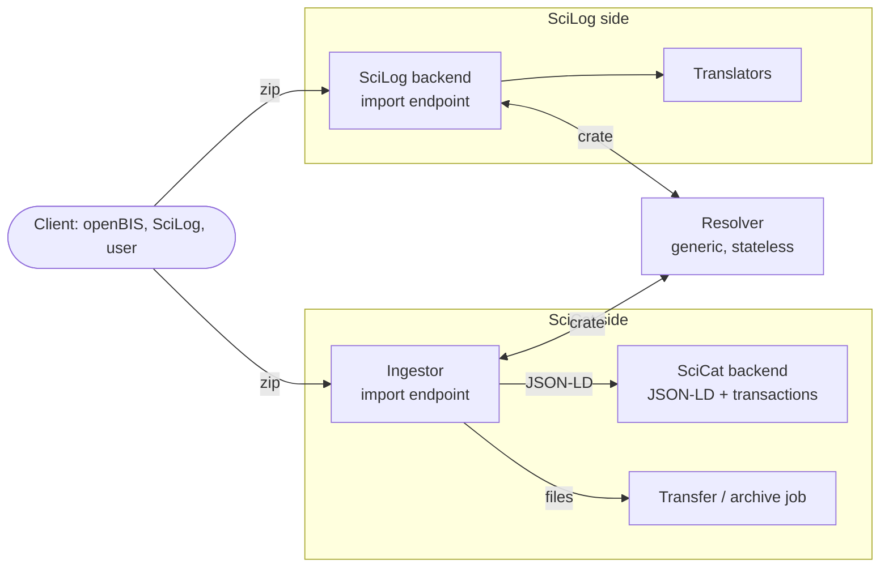
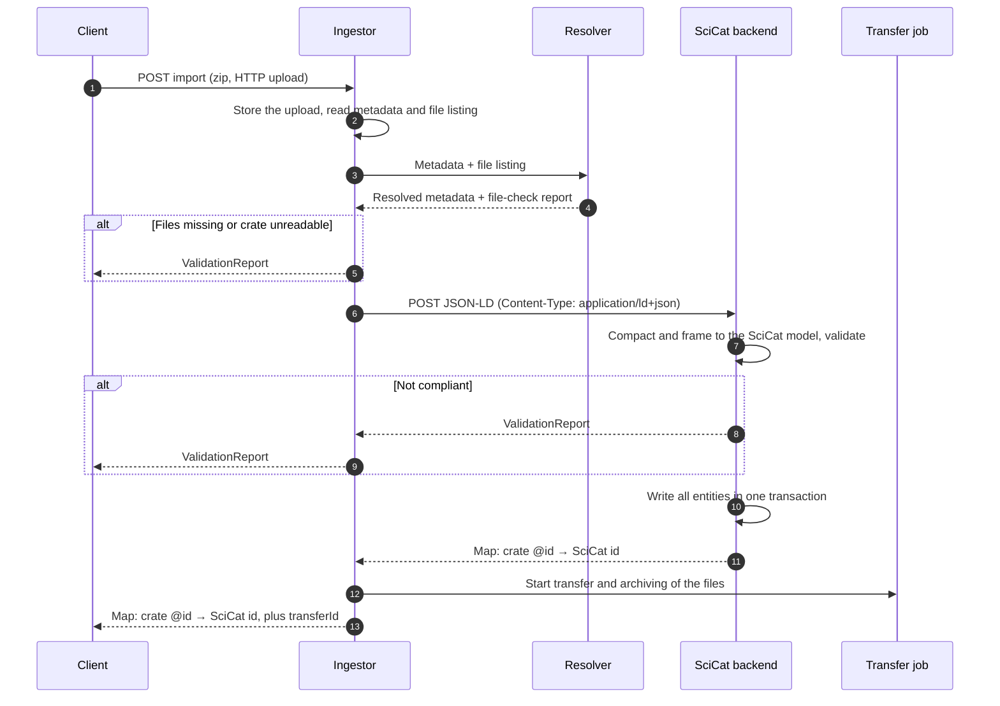
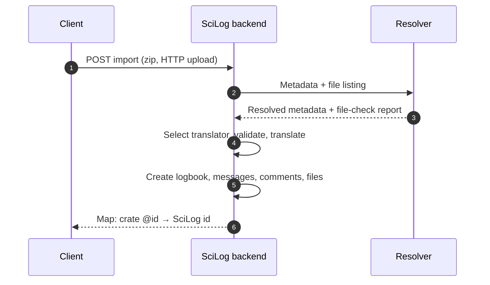
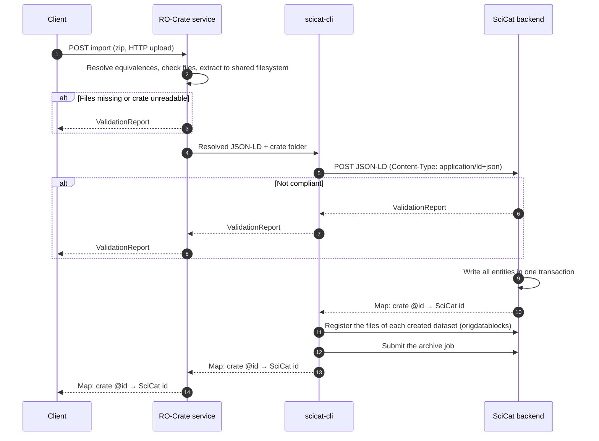

# Proposal: RO-Crate import architecture

Status: proposal, not implemented.

This document proposes how RO-Crate import should be split across components, so that SciCat and SciLog can
receive crates through the same API, each interpreting the content in its own way. It's written for the
maintainers of the components involved: the RO-Crate service (this repository), the
[Ingestor](https://github.com/SwissOpenEM/Ingestor), the [SciCat backend](https://github.com/SciCatProject/backend),
SciLog and openBIS.

## Context

Today the SciCat RO-Crate service (this repository) does five things in one process:

| Concern | Where it is today |
|---|---|
| Unpacking the zip, checking paths and file presence | `RoCrate` |
| Parsing JSON-LD and resolving equivalences (OWL reasoning) | `RoCrateImporter` |
| Validating against the SciCat model | annotations in `ch.psi.rdf` and `ch.psi.ord.model` |
| Mapping to SciCat DTOs | `ScicatModelMapper` |
| Moving data: scicat-cli, a shared NFS, archive jobs | `ScicatCli`, `RoCrateImporter.submitArchiveJob` |

This combination has several consequences:

- **SciCat-specific rules live outside SciCat.** The service's model, its documentation and the shared API
  specification drifted apart.
- **Imports aren't atomic.** A crate with several entities is written to SciCat one entity at a time, so a failure
  half-way leaves some of them created.
- **Data transfer is synchronous and needs a shared filesystem** between the service and scicat-cli.
  openBIS's integration design expects asynchronous processing instead (see [openbis-scicat.md](openbis-scicat.md)).
- **There's no reusable piece for other receivers.** SciLog implemented its own `.eln` import with a different
  interface, although its logic follows the same design (per-source profiles, validation before import,
  structured errors).

## Goals

- One generic, receiver-independent step that every receiver can use: resolving the equivalences declared in a
  crate and checking that its files are present.
- Each receiver interprets and validates the crate content against its own model and profile.
- SciCat writes the metadata of a crate in one transaction, and transfers files through a job.
- SciCat and SciLog expose the same import API to clients.

Non-goals: defining crate content in the shared API, or changing the ELN file format.

## Components



| Component | Responsibility | Knows about SciCat or SciLog? |
|---|---|---|
| Resolver | Parse the crate, resolve the equivalences it declares, check that referenced files are present | No |
| Ingestor | SciCat's entry point: accepts the HTTP upload, calls the resolver, splits metadata from files, sends the JSON-LD to the backend, starts the transfer job, answers the client | Only as an orchestrator |
| SciCat backend | Understands JSON-LD in SciCat's profile, validates it, writes it in one transaction, returns the identifier map; also serves JSON-LD on read | Yes, it owns SciCat's profile |
| SciLog backend | SciLog's entry point: accepts the HTTP upload, calls the resolver, translates and imports with its existing translators | Yes, it owns SciLog's profiles |

## Resolver

A small, stateless HTTP service: crate in, resolved crate out. What remains of this repository would be this
component, since it's built on Apache Jena, which is well suited for the reasoning.

**It does:**

1. Parse `ro-crate-metadata.json` (at the zip root, or in a single top-level folder as in the ELN format).
2. Resolve the equivalences **declared in the crate** (`owl:equivalentClass`, `owl:equivalentProperty`,
   `rdfs:subClassOf`), using a fixed, generic vocabulary preference instead of any receiver's terms:
   schema.org, then DataCite, then the crate's own terms.
   - An equivalent property or class is rewritten to the preferred term, and the original term is dropped, so that
     receivers don't import the same information twice.
   - A subclass gets its supertype added to `@type`. The original type stays.
3. Check that every local data entity referenced in the metadata is present in the zip.
4. Return the crate flattened and compacted against the RO-Crate context, so that receivers can process it as
   plain JSON.

**It doesn't** know any receiver's model, validate content against a profile, or modify data files.

**Transport.** Files never need to pass through the resolver, because only the metadata changes. The resolver
takes the metadata and the zip's file listing (cheap to read from the zip's central directory) and returns the
resolved metadata plus a file-check report. The caller replaces `ro-crate-metadata.json` in its own copy of
the zip, so large archives aren't moved between services.

**Errors** use the shared `ValidationReport` format (for example `MissingDataError`).

### Resolver endpoint: `POST {resolver}/resolve`

This endpoint is internal: receivers call it, clients don't.

**Request** (`Content-Type: application/json`):

```json
{
  "metadata": { "@context": "https://w3id.org/ro/crate/1.1/context", "@graph": [ "…" ] },
  "files": ["data/", "data/file1.txt", "data/file2.h5"]
}
```

- `metadata`: the content of `ro-crate-metadata.json`, unchanged.
- `files` (optional): the paths in the zip, relative to the crate root, as read from the zip's file listing.
  Without it, the file check is skipped, for example for a metadata-only crate.

**Response `200 OK`:**

```json
{
  "metadata": { "@context": "https://w3id.org/ro/crate/1.1/context", "@graph": [ "…" ] },
  "report": {
    "isValid": false,
    "errors": [
      {
        "errorType": "MissingDataError",
        "path": "data/file2.h5",
        "message": "The path 'data/file2.h5' is referenced in the metadata but absent from the archive"
      }
    ]
  }
}
```

- `metadata`: the resolved crate metadata, flattened and compacted against the RO-Crate context.
- `report`: the file check and any problem found while resolving, in the shared validation report format.
  The receiver decides what to do with it, usually rejecting the crate when `isValid` is `false`.

`400` means the metadata can't be parsed as JSON-LD, or has no metadata descriptor or root data entity.

## Import into SciCat



### Changes in the Ingestor

- Implement the shared import endpoint (and the validation endpoint), accepting the crate as an **HTTP upload**.
  Today the Ingestor ingests from folders on its own filesystem (`/dataset/browse`, `POST /dataset`).
- Support **machine-to-machine authentication** for clients such as openBIS, in addition to the current
  OIDC browser session.
- Split the crate: send the resolved JSON-LD to the backend, and the files to the existing transfer mechanism
  (Globus or S3) as a job.
- Return the identifier map from the backend together with the `transferId`. Today the Ingestor returns a single
  `datasetId`.
- Relay validation errors from the resolver and the backend unchanged, so that clients see one error format
  whichever layer rejected the crate.

### Changes in the SciCat backend

- **Accept JSON-LD** on create: `Content-Type: application/ld+json`.
- **Understand it through SciCat's JSON-LD context.** The context is designed so that compacting and framing the
  incoming JSON-LD (for example with jsonld.js) yields JSON shaped like the backend's existing DTOs. The existing
  DTO validation then rejects content that doesn't comply, without a separate validation engine.
- **Write all entities of a crate in one transaction** (datasets, published data, the links between them), and
  return the map from crate `@id` to the created id. MongoDB multi-document transactions require a replica-set
  deployment.
- **Serve JSON-LD on read:** `Accept: application/ld+json` on datasets and published data returns the same
  representation. This replaces the export logic in this repository and the Zenodo exporter.
- **Own SciCat's profile:** the JSON-LD context and the SHACL shapes, both generated from one LinkML schema (a
  draft exists in this repository under `profile/`).

## Import into SciLog



SciLog already has most of this: `POST /logbooks/import/eln` with per-source translators (SciLog, openBIS), validation
before import and structured errors. The changes are:

- Expose the import through the shared endpoint (raw zip upload, the identifier map as the response, errors in the
  shared format), alongside the existing multipart endpoint used by the web UI.
- Call the resolver before selecting a translator. Translators can then rely on resolved terms. Restructuring
  (for example nesting comments under messages, or extracting HTML bodies) stays in the translators, because
  equivalences only rename terms.

## Export from SciLog to SciCat

SciLog already exports a logbook in SciCat's shape (`ScicatCrateService`), and the web UI uploads it to SciCat.
In this architecture that becomes "export in the receiver's profile, then import":

1. The client exports the logbook from SciLog, requesting SciCat's profile.
2. The client imports the crate into SciCat through the Ingestor, as described above.

The client holds credentials for both systems, so no server needs to call another one.

## Profiles and schemas

| Artifact | Owner | Location |
|---|---|---|
| SciCat profiles, core and full (JSON-LD context, SHACL, LinkML source; see [Profile tiers](#scicat-profile-tiers-core-and-full)) | SciCat backend | SciCat backend repository |
| SciLog ELN profile | SciLog | SciLog repository (`docs/Ingestor/eln-conventions.md`) |
| openBIS profile | openBIS | SIS RO-Crate repository |
| Equivalences between vocabularies | the producer of a crate | inside the crate (`owl:equivalentClass`, `owl:equivalentProperty`) |
| Vocabulary preference used by the resolver | the resolver | resolver configuration (schema.org, DataCite, then custom terms) |

Profile support is declared per direction: a system may produce a profile it can't import (SciLog exports in
SciCat's profile), and the reverse.

## What a crate creates in SciCat

A SciCat record is built by three components, and the crate only feeds the first one:

| SciCat record | Created by | From |
|---|---|---|
| Datasets, published data, people, scientific metadata (and, later, samples and other entities) | SciCat backend | the crate's metadata |
| Origdatablocks (the file listing: paths, sizes, checksums) | scicat-cli, later the Ingestor | the actual files |
| Datablocks, archive status | the archive system | the archiving job |

Consequences:

- **File entities in a crate are claims by the producer.** `contentSize`, `sha256` and `encodingFormat` on a
  `File` describe what the producer sent. The origdatablocks are computed from the files that actually arrived.
  Where the crate declares a checksum or a size, the component handling the files compares it with what it
  computed, and a mismatch is an import error. (SciLog's ELN archives already carry `sha256` checksums.)
- **Atomicity covers the metadata.** The backend writes a crate's metadata in one transaction. The origdatablocks
  follow when the files are processed, and the datablocks at archiving. A dataset therefore exists for a while
  without its file listing, as it does in SciCat today.
- **SciCat's export profile is a superset of its import profile.** An exported crate also contains what SciCat
  computed or obtained later (file listings with sizes and checksums, archive status, download URLs). If such a
  crate is imported again, that information is checked as a claim, not recreated as records.

## Beyond datasets: samples, instruments, proposals

A crate can describe much more than the datasets: the samples that were measured, the instrument, the proposal,
the techniques used. Describing all of SciCat's models in JSON-LD by hand would be a very large job. Split into
two layers, most of it is mechanical.

**Layer 1: a SciCat vocabulary, generated.** Every SciCat model is already formally defined by the backend's DTOs
and its OpenAPI document. From those, a 1:1 vocabulary is generated: each field becomes a term in a `scicat:`
namespace, each type an XSD datatype, each reference (`sampleId`, `proposalId`, `instrumentId`) an `@id` link.
LinkML can import the JSON Schemas in the OpenAPI document, so the chain is mechanical: OpenAPI → LinkML →
JSON-LD context and SHACL. It covers every model and is kept in sync by regenerating, not by hand.

**Layer 2: equivalences to standard vocabularies, by hand, only where useful.** On top of the generated
vocabulary, equivalences are declared (`scicat:datasetName` ≡ `schema:name`) only where a standard term means the
same thing. Good targets are schema.org (datasets, people, organisations, publications), PaNET (techniques,
which SciCat already uses for technique ids), and Bioschemas' `Sample` or PROV (samples). This layer never needs
to be complete: a producer can always use the `scicat:` terms directly.

**The backend imports model by model, as producers need them.** For each model, the work is a frame, a rule for
creating or linking records, and a few equivalences. Samples are the likely first candidate, because openBIS is
organised around samples.

The hard questions are about identity and ownership, not vocabulary:

- **Create or link.** A sample described in a crate may be new, or may already exist in SciCat. A rule is
  needed, for example: an `@id` that is a SciCat sample URL or PID links to that sample; any other `@id` creates
  a new one.
- **Duplicates.** Two crates describing the same physical sample mustn't create two records. That requires a
  stable external identifier (for example openBIS's sample identifier) stored in SciCat.
- **Permissions.** Whether the importing user may link to a sample or proposal owned by another group.
- **Free-form parts.** `sampleCharacteristics`, like `scientificMetadata`, are open-ended. They map best through
  `PropertyValue` entries, as datasets' `variableMeasured` does.

## SciCat profile tiers: core and full

A profile that covers every SciCat model is too large for most clients to work with. SciCat therefore publishes
its import profile in two tiers:

| | Core profile | Full profile |
|---|---|---|
| Vocabulary | Standard terms only: schema.org, plus a short, named list of established domain vocabularies (Bioschemas `Sample`, PaNET techniques) | Core plus the generated `scicat:` terms |
| Size | A handful of entities and properties | Every SciCat field |
| Documentation | Written by hand: one page with examples | Generated reference (LinkML `gen-doc`) |
| Intended for | Most clients, including generic RO-Crate tools | Clients that need SciCat-specific fields, such as links to proposals or instruments, the dataset type, or specific technique ids |
| Changes | Rarely | Whenever SciCat's model changes, by regenerating |

- **The full profile is a strict superset of core.** A client can start with core and add individual `scicat:`
  terms when it needs them, without adopting the whole full profile.
- **Clients don't need to know SciCat to use core.** A crate in core is what standard RO-Crate tooling
  (ro-crate-py, ro-crate-js) produces anyway. SciLog's current SciCat crate is essentially a core crate already.
- **Core matches the resolver's output.** A crate whose producer declared equivalences to standard terms comes out
  of the resolver in core terms.
- **Fields SciCat requires but core can't express get defaults.** The backend derives or defaults them (for
  example the owner from the creators, the contact email from the uploading user). The core documentation lists
  every default.
- **Core is also the default for export.** `Accept: application/ld+json` returns core, which harvesters and other
  systems understand. The full profile is returned on request with `Accept-Profile`.
- **Keep core's vocabulary list short.** schema.org alone can't describe samples, so core needs a few domain
  vocabularies. Each one added is something every client has to learn.

Both tiers are listed by `GET {base}/import/profiles` and `GET {base}/export/profiles`.

## Generating the profiles in the backend's CI

The generated vocabulary comes from the backend's own models, so it's generated in the backend repository,
whenever the models change. The backend's CI already has the hard part:
`upload-sdk-artifact.yml` and `release-and-publish-sdk.yml` start the backend, download its OpenAPI document from
`/explorer-json`, store it as an artifact, and generate the client SDKs from it. The profile generation is one
more consumer of that artifact.

### Files in the backend repository

```
rocrate-profile/
├── generated/
│   └── scicat.yaml          # LinkML generated from the OpenAPI document; never edited by hand
├── scicat-full.yaml         # hand-written: imports generated/, adds the equivalences (layer 2)
│                            #   and excludes system-managed fields
├── scicat-core.yaml         # hand-written: the core subset, in standard terms
├── core.md                  # hand-written documentation of core, including the defaults
└── examples/
    ├── valid/               # example crates that must pass
    └── invalid/             # example crates that must fail, with the expected errors
```

- **Generated and hand-written files are separate.** Regenerating never overwrites a hand-written decision.
- **System-managed fields are excluded from the full profile:** database ids, timestamps, `createdBy` and
  `updatedBy`, access and ownership fields. They're set by SciCat, not by a crate.
- **`generated/scicat.yaml` is committed.** A change to a DTO then shows up in the pull request as a change to the
  public vocabulary, which is what it is.

### The workflow

A job added to `upload-sdk-artifact.yml` (or a new workflow with the same triggers), depending on the job that
exports the OpenAPI document, like the SDK job does:

1. **Download** the OpenAPI artifact from the export job.
2. **Generate the vocabulary:** convert the OpenAPI document's JSON Schemas to LinkML with
   [schema-automator](https://github.com/linkml/schema-automator), and write the result to
   `rocrate-profile/generated/`.
3. **Check that it's up to date:** fail if the generated file differs from the committed one, so that every model
   change comes with its vocabulary change in the same pull request.
4. **Build the artifacts** for both tiers with the LinkML generators: the JSON-LD context
   (`gen-jsonld-context`), the SHACL shapes (`gen-shacl --non-closed`), and the reference documentation
   (`gen-doc`).
5. **Test:**
   - every crate in `examples/valid/` passes, and every crate in `examples/invalid/` fails with the expected
     errors (pySHACL);
   - every valid core example also passes the full profile, which checks that full is a superset of core;
   - the hand-written files only refer to terms that exist in the generated vocabulary, so that a renamed DTO field
     breaks the build instead of silently breaking an equivalence.
6. **Publish**, on releases only:
   - attach the contexts and SHACL shapes to the GitHub release, versioned with the backend;
   - add the reference documentation and `core.md` to the documentation site, through the existing
     `publish-docs.yml`;
   - point the profiles' permanent URIs (for example on `w3id.org`) to the released files.

The core profile changes only when someone edits `scicat-core.yaml`, so model changes that don't touch core don't
affect most clients. The full profile follows the backend's releases.

## Shared API

The endpoints below are what clients call. They're implemented by each receiver's entry point: for SciCat, the
RO-Crate service in the first step and the Ingestor in the target architecture; for SciLog, the SciLog backend. The resolver isn't part of this API; it's an internal component
used by both receivers.

The API defines how crates are exchanged, not what they contain. What a receiver accepts is defined by its
profiles, which it advertises through the API.

Identifiers, profile URIs and URLs in the examples are illustrative.

### General rules

- **Base URL.** Every receiver chooses its own base URL, for example `https://scicat.example.org/ingestor` or
  `https://scilog.example.org/api`. All paths below are relative to it, written `{base}`.
- **Authentication** is defined by each receiver: API keys, OIDC tokens, or a session. The API doesn't prescribe
  a scheme.
- **Implementation-specific parameters** are allowed as query parameters or headers, and each receiver documents
  them. Examples: SciCat's owner group, SciLog's target location. Clients must not expect another receiver to
  understand them.
- **Crate layout.** A zipped crate has `ro-crate-metadata.json` either at the root of the archive or in a single
  top-level folder (the ELN file format layout).
- **Errors** use one format (the validation report below), whichever component found the problem.

### Endpoints

| Method and path | Purpose | Required? |
|---|---|---|
| `POST {base}/import` | Import a crate | yes |
| `POST {base}/validate` | Check whether `import` would accept a crate, without importing it | yes |
| `GET {base}/import/profiles` | List the profiles the receiver can import | yes |
| `POST {base}/export` | Export records as a crate | optional |
| `GET {base}/export/profiles` | List the profiles the receiver can export to | required if `export` is implemented |
| `GET {base}/transfers/{transferId}` | Follow a file transfer started by an import | required if `import` can return a `transferId` |

### `POST {base}/import`

**Request.** The body is the crate. Its headers:

| Header | Required? | Value |
|---|---|---|
| `Content-Type` | yes | `application/zip` for a zipped crate with its data files, or `application/ld+json` for the metadata only, when there are no files to transfer |
| `Content-Profile` | no | The profile the crate follows, as a URI in angle brackets, for example `<https://w3id.org/scicat/rocrate-profile/1.0>`. It must be one of the receiver's import profiles. |

The receiver determines the crate's profile in this order:

1. the `Content-Profile` header, if present;
2. otherwise `conformsTo` on the crate's root data entity;
3. otherwise its own detection, for example by the crate's publisher (`sdPublisher`).

If the header and `conformsTo` name different profiles, the receiver rejects the crate with `422` and an
`UnsupportedProfile` error. If the profile isn't one of the receiver's import profiles, it does the same.

Declaring the profile in the header lets a receiver choose its checks before it reads the crate, and works the
same way for zipped and metadata-only crates.

**Response `201 Created`:**

```json
{
  "entities": {
    "data/": "20.500.11935/44e91ab9-9ed5-4742-8a73-7834fbd0535e",
    "https://doi.org/10.16907/808de0df-a9d3-4698-8e9f-d6e091516650": "10.16907/808de0df-a9d3-4698-8e9f-d6e091516650"
  },
  "truncated": false,
  "transferId": "3f6c1f0e-8a52-4d0b-9a41-2b9f5d0c7e11"
}
```

- `entities` maps each imported entity's `@id`, exactly as written in the crate and relative to the crate root,
  to the identifier the receiver created for it (a DOI, a PID, a logbook id, …).
- `truncated` is `true` when the receiver lists only part of the entities, for example only the top-level ones
  of a very large crate. The receiver documents what it lists in that case.
- `transferId` is present when the data files are still being transferred after the metadata was imported. The
  metadata is already stored at this point; the files follow. Use `GET {base}/transfers/{transferId}` to
  follow the transfer.

**Errors:**

| Status | Meaning | Body |
|---|---|---|
| `400` | The crate can't be read: not a zip, invalid JSON-LD, no metadata descriptor, no root data entity | message |
| `401` / `403` | Not authenticated, or not allowed to import | message |
| `409` | The crate describes something the receiver has already imported | message |
| `413` | The upload is larger than the receiver accepts | message |
| `422` | The crate can be read but doesn't comply with the receiver's profile, or files are missing | validation report |

### `POST {base}/validate`

Same request as `import`, with the same `Content-Type` and `Content-Profile` headers. It runs every check that
`import` runs (the resolver's file checks and the receiver's profile checks) and stores nothing.

**Response `200 OK`** with a validation report, whether the crate is valid or not. `400` is returned only when
the crate can't be read at all.

### Validation report

```json
{
  "isValid": false,
  "entities": ["https://doi.org/10.16907/808de0df-a9d3-4698-8e9f-d6e091516650"],
  "errors": [
    {
      "errorType": "PropertyError",
      "nodeId": "#jane",
      "property": "http://schema.org/email",
      "message": "Missing required property"
    },
    {
      "errorType": "MissingDataError",
      "path": "data/file2.h5",
      "message": "The path 'data/file2.h5' is referenced in the metadata but absent from the archive"
    }
  ]
}
```

- `isValid`: whether `import` would accept the crate.
- `entities`: the `@id`s of the entities the receiver would import.
- `errors`: one entry per problem. Every entry has an `errorType` and a human-readable `message`. Other fields
  depend on the kind of error.

Known error kinds:

| `errorType` | Meaning | Extra fields |
|---|---|---|
| `PropertyError` | A property is missing, has too many values, or has the wrong type | `nodeId`, `property` |
| `MissingDataError` | A file or directory referenced in the metadata isn't in the zip | `path` |
| `NoEntityFound` | The crate contains nothing the receiver can import | |
| `UnsupportedProfile` | The crate's profile isn't one the receiver imports | `profile` |

Receivers may add their own kinds. Clients must accept kinds they don't know, and should show their `message`.

### `GET {base}/import/profiles` and `GET {base}/export/profiles`

Each returns a list of profiles. The two lists are separate because a receiver may export in a profile it can't
import, or the reverse. For example, SciLog can export in SciCat's profile, but can't import it.

```json
[
  {
    "id": "https://w3id.org/scicat/rocrate-profile/1.0",
    "name": "SciCat",
    "documentation": "https://github.com/SciCatProject/backend/tree/master/rocrate-profile",
    "shapes": [{ "href": "https://…/scicat-profile.shacl.ttl", "mediaType": "text/turtle" }],
    "mediaTypes": ["application/zip", "application/ld+json"]
  }
]
```

| Field | Required? | Meaning |
|---|---|---|
| `id` | yes | The profile's permanent URI. It's the value used in `conformsTo` and in `Accept-Profile`. |
| `name` | no | Human-readable label |
| `documentation` | no | Link to the profile's human-readable description |
| `shapes` | no | Links to machine-readable constraints (for example SHACL), each with its media type. Clients can use them to check a crate before sending it. |
| `mediaTypes` | no | Payload types the profile is accepted or produced in (for example `application/vnd.eln+zip` for an ELN archive) |
| `default` | no | Export only: the profile used when the client doesn't ask for one |

### `POST {base}/export`

**Request.** The body is a JSON list of identifiers of the records to export: DOIs, system-specific
identifiers, or both, depending on the receiver.

```json
["10.16907/808de0df-a9d3-4698-8e9f-d6e091516650"]
```

Request headers:

| Header | Required? | Value |
|---|---|---|
| `Content-Type` | yes | `application/json` (the list of identifiers) |
| `Accept` | yes | `application/zip` for metadata and data, or `application/ld+json` for the metadata only |
| `Accept-Profile` | no | The profile the crate should follow, for example `<https://w3id.org/scicat/rocrate-profile/1.0>`. It must be one of the receiver's export profiles. Without it, the receiver uses its default export profile. |

`Accept-Profile` and `Content-Profile` follow the W3C
[content negotiation by profile](https://www.w3.org/TR/dx-prof-conneg/) recommendation.

**Response `200 OK`:** the crate, with these headers:

| Header | Value |
|---|---|
| `Content-Type` | `application/zip` or `application/ld+json`, as requested |
| `Content-Profile` | The profile the returned crate follows. The crate also declares it with `conformsTo` on its root data entity, so that it keeps the information when it's stored as a file. |

**Errors:**

| Status | Meaning |
|---|---|
| `400` | An identifier the receiver doesn't support (for example a non-DOI on a DOI-only receiver) |
| `404` | A well-formed identifier that doesn't exist |
| `406` | The receiver can't export in the requested profile or media type |
| `422` | The record can't be expressed in the requested profile, for example because required data is missing |

### `GET {base}/transfers/{transferId}`

Returns the state of a file transfer started by an import:

```json
{
  "transferId": "3f6c1f0e-8a52-4d0b-9a41-2b9f5d0c7e11",
  "status": "RUNNING",
  "message": "12 of 40 files transferred"
}
```

`status` is one of `SCHEDULED`, `RUNNING`, `COMPLETED` or `FAILED`. For SciCat, this is the Ingestor's
existing transfer tracking, exposed under this path.

### Example: exporting a logbook from SciLog to SciCat

1. `GET {scicat}/import/profiles` lists SciCat's profile, and `GET {scilog}/export/profiles` lists the same
   profile id. So the transfer is possible.
2. `POST {scilog}/export` with `Accept: application/zip` and `Accept-Profile: <SciCat's profile id>`, with the
   logbook id in the body, returns a crate in SciCat's profile.
3. `POST {scicat}/import` with that crate returns the created dataset's PID and a `transferId`.
4. `GET {scicat}/transfers/{transferId}` until the files are `COMPLETED`.

### Differences from the current RO-Crate service API

The current service (`/api/v1/ro-crate/…`) stays unchanged during the migration. This API differs from it in
these ways:

| Current service | This API |
|---|---|
| Fixed paths under `/api/v1/ro-crate` | Paths relative to a base URL chosen by each receiver |
| `api-key` header | Authentication defined by each receiver |
| The import response is a flat map of `@id` → id | An object with `entities`, `truncated` and `transferId` |
| Invalid crates return `400` with a validation report | Invalid crates return `422` with a validation report; `400` only means the crate can't be read |
| The error kind is in `type` | The error kind is in `errorType` |
| `Export` header chooses the format | Standard `Accept` header, plus `Accept-Profile` for the profile |
| The profile isn't declared on import | `Content-Profile` header, or `conformsTo` in the crate |
| No profile discovery | `import/profiles` and `export/profiles` |
| Synchronous; data is moved before the response | Metadata is imported synchronously; files follow through a transfer job (`transferId`) |

## First step: upload in the RO-Crate service, ingestion with scicat-cli

Moving the upload to the Ingestor needs changes there (HTTP upload, machine authentication, splitting crates).
As a first step, SciCat can get the same API and the same division of responsibilities without touching the
Ingestor. The resolver and SciCat's import, including the file transfer through scicat-cli, stay in one
service (this repository), but **as two separate endpoints**:

| Endpoint | Purpose | Called by |
|---|---|---|
| `POST {resolver}/resolve` | Resolve equivalences and check files (see [Resolver endpoint](#resolver-endpoint-post-resolverresolve)). Knows nothing about SciCat. | SciLog, and SciCat's import below |
| The shared API (`import`, `validate`, `import/profiles`, …) | SciCat's import: resolve, then ingest with scicat-cli | Clients |

Keeping the two apart is what lets SciLog use the resolver now, and lets the Ingestor take over SciCat's import
later without changing the resolver.

- **The RO-Crate service (this repository) stays SciCat's entry point.** It implements the shared API endpoints,
  receives the upload, calls its own resolver, and extracts the crate to the shared filesystem, as it does today.
- **scicat-cli gains a JSON-LD input.** Instead of a SciCat `metadata.json`, it takes the resolved JSON-LD and the
  folder of the extracted crate. It sends the JSON-LD to the backend (`Content-Type: application/ld+json`), and
  then registers the files of each created dataset and submits the archive job, as it does today.
- **The SciCat backend implements JSON-LD create with transactions**, exactly as in the target architecture.



**How scicat-cli finds the files of a dataset.** For each created dataset whose crate `@id` is a directory in the
crate (for example `data/`), scicat-cli registers the files under that directory. Files that a crate attaches
directly to a publication, without a directory dataset around them, need a rule in SciCat's profile (for example,
the backend creates one dataset for them, as the current service does). That rule belongs to the backend's
JSON-LD interpretation, not to scicat-cli.

**What this step achieves:**

- The SciCat model mapping (`ScicatModelMapper`, the model annotations) leaves this repository for the backend.
  What remains here is the upload, the resolver and the call to scicat-cli.
- The metadata of an import is written atomically, thanks to the backend transaction.
- Clients use the shared API from this point on, and don't change again when the Ingestor takes over.
- The backend and scicat-cli work isn't throwaway. The backend's JSON-LD support is the target design, and
  scicat-cli's JSON-LD input remains useful for command-line ingestion.

**What it doesn't change yet:** ingestion still needs the shared filesystem between the RO-Crate service and
scicat-cli, and file registration is still synchronous. That's what the move to the Ingestor removes.

## Open questions

1. **openBIS:** does its integration need asynchronous import, or does it handle a synchronous response? With
   this design, the metadata is imported synchronously and only the file transfer is asynchronous
   (`transferId`).
2. **Consistency between metadata and files:** the metadata transaction commits before the file transfer
   finishes. SciCat already models this (dataset lifecycle and archive status), but the import response must make
   clear that the data transfer is still pending.
3. **MongoDB deployment:** do the production SciCat instances run as a replica set, which transactions require?
4. **Ingestor authentication:** which mechanism for machine clients (service accounts, API keys, OIDC client
   credentials)?
5. **Resolver deployment:** a shared service, or one instance next to each receiver?
6. **SciCat backend governance:** JSON-LD support is a change to a community project and needs an upstream
   proposal.
7. **Upload size limits** for the Ingestor and SciLog, and whether large crates should be uploaded in chunks.
8. **Create or link, duplicates and permissions** for entities beyond datasets (see
   [Beyond datasets](#beyond-datasets-samples-instruments-proposals)).
9. **Which domain vocabularies belong in the core profile**, and who decides when one is added.

## Migration from the current service

**First step** (see [above](#first-step-upload-in-the-ro-crate-service-ingestion-with-scicat-cli)):

1. Add JSON-LD read support to the SciCat backend (`Accept: application/ld+json`). It's independent of the import
   path, and replaces the export logic in this repository.
2. Add JSON-LD create support and transactions to the SciCat backend, together with SciCat's profiles and the
   CI workflow that generates them (see [Generating the profiles](#generating-the-profiles-in-the-backends-ci)).
3. Add a JSON-LD input to scicat-cli: send the JSON-LD to the backend, then register the files of each created
   dataset and submit the archive job.
4. In this repository, separate the resolver (the generic parts of `RoCrate` and `RoCrateImporter`: zip handling,
   file checks, JSON-LD parsing, reasoning) from the SciCat model, and remove the SciCat model mapping. Expose
   the resolver as its own endpoint, `POST /resolve`, so that SciLog can call it. Implement the shared API
   endpoints for SciCat, calling the resolver and then scicat-cli.
5. Move SciLog's import to the shared endpoint, calling the resolver.

**Target:**

6. Add the HTTP upload and the shared API endpoints to the Ingestor: call the resolver, send the JSON-LD to the
   backend, and transfer the files with a job.
7. Switch SciCat's clients to the Ingestor. This repository is then reduced to the resolver.

The current `/api/v1/ro-crate` endpoints keep running until clients have switched to the shared API, so existing
clients (SciLog, openBIS) aren't affected during the transition.
